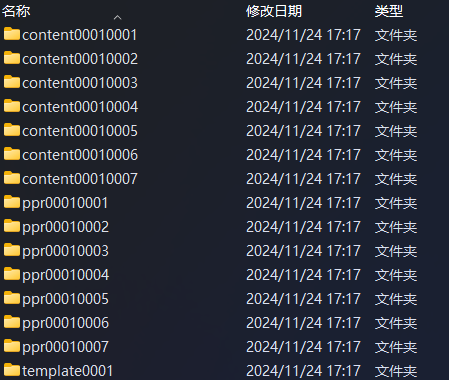
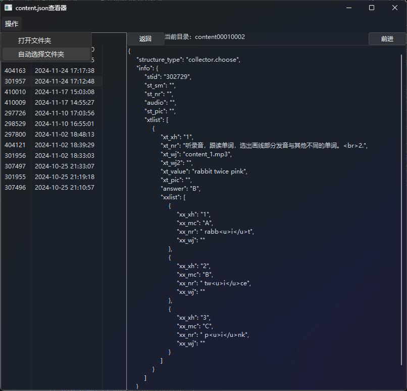

# EtsViewer

一个简洁高效的 ETS 考试内容查看器，支持美观格式化输出和文本导出。



## 功能特性

- 📁 **自动识别** - 自动查找 ETS 数据目录
- 🎨 **美观输出** - 将 JSON 内容格式化为易读的文本
- 📝 **多题型支持** - 支持角色扮演、图片描述、选择题、阅读理解等多种题型
- 💾 **导出功能** - 一键导出为 TXT 文件，方便分享
- ⌨️ **快捷操作** - 支持键盘快捷键翻页和缩放



## 安装

```bash
pip install -r requirements.txt
```

需要 Python 3.10+（使用了 `X | None` 类型写法）。

## 使用方法

1. 运行 `python main.py` 启动程序
2. 通过菜单「操作」→「自动选择文件夹」或「打开文件夹」加载数据
3. 在左侧列表选择要查看的作业
4. 右侧面板查看内容，支持以下操作：
   - 勾选「启用美观输出」查看格式化内容
   - 勾选「显示完整答案」查看所有参考答案（不勾选时只显示前 3 条，选择题不显示答案）
   - 点击「导出为TXT」保存内容

## 快捷键

| 快捷键 | 功能 |
|--------|------|
| `Ctrl + ←` | 上一条内容 |
| `Ctrl + →` | 下一条内容 |
| `Ctrl + 滚轮` | 调整字体大小（6–72） |
| 点击目录标题 | 快速切换题目 |

## 项目结构

```
EtsViewer/
├── main.py          # 程序入口与主窗口
├── widgets.py       # 自定义控件（列表、内容查看器）
├── formatters.py    # 各题型的 JSON 格式化
├── utils.py         # 工具函数（字体缓存、HTML 清理）
├── mypy.ini         # 类型检查配置
├── build.bat        # 打包脚本（Nuitka + UPX）
└── requirements.txt # 依赖列表
```

## 开发

类型检查使用 mypy 严格模式：

```bash
pip install mypy
python -m mypy .
```

## 验证

```bash
python verify.py            # 自动定位 %APPDATA%\ETS
python verify.py --root D:\题库
python verify.py --skip-ui  # 无 GUI 环境时跳过控件链路
```

校验内容：

- **逐词覆盖** —— 源数据里的每个词都必须出现在输出里，输出里也不能出现源数据没有的词
- **顺序** —— 每个字段的词序必须原样连续出现
- **标签泄漏** —— 绕过 `clean_html_tags` 直接拼接的字段（`keywords`/`topic`/`image`）是否带标签
- **控件链路** —— 真实目录走一遍 `init_data` + 逐条渲染，检查条目数与空渲染
- **内置 fixture** —— 覆盖本机可能没有真实数据的 `choose` / `word` / `repeat_essay` / `repeat_dialogue`
- **清理契约** —— `</br>`/`<br>`/`<p>` 必须转成换行、实体要解码、空值要安全

期望值用独立的参考清理函数计算，不复用 `utils.clean_html_tags`，
否则被过滤函数自身的 bug 会让两边一起偏移、校验失效。

## 打包

使用 Nuitka 打包为**文件夹形式**（非单文件），输出在 `build/EtsViewer/`：

```bash
build.bat
```

脚本会自动完成：创建 `.venv` → 安装 `nuitka`/`wxPython`/`ziglang` → 编译 → 用 UPX 压缩。

关于编译器：本机 MSVC 缺少 Windows SDK 时无法使用，而 Nuitka 在 Python 3.13+ 上禁止 `--mingw64`，
因此脚本把 `CC` 指向 venv 内的 `ziglang`，由 Zig 完成 C 编译。

体积优化手段与效果（19 个文件）：

| 阶段 | 体积 |
|------|------|
| Nuitka standalone 原始产物 | 37 MB |
| 裁掉未使用的 wx 子模块（`wx.adv`/`wx.html`/`wx.net` 等） | 35 MB |
| UPX `--best --lzma` | **11 MB** |

说明：

- `--lto=yes` 与 Zig 后端不兼容（链接期报 `__QNANF` 等未定义符号），故未启用。
- UPX 压缩会略微增加启动耗时（首次解压），且可能触发个别杀毒软件误报；
  删掉 `tools/` 目录后重新打包即可得到未压缩版本。
- 产物依赖 `msvcp140.dll` / `vcruntime140.dll`，已随包附带，目标机无需另装 VC++ 运行库。

## 依赖

- wxPython >= 4.2.2

## License

MIT
